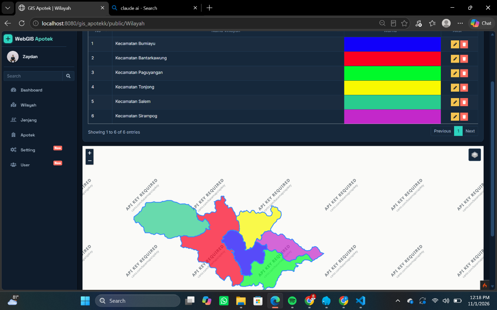

# WebGIS Apotek

Aplikasi WebGIS untuk melihat dan mengelola lokasi apotek. Panduan ini ditujukan untuk menjalankan aplikasi secara lokal di laptop Windows menggunakan Laragon.

## Latar belakang dan tujuan

Informasi lokasi apotek akan lebih mudah dipahami jika ditampilkan bersama peta wilayah. WebGIS Apotek membantu pengguna menemukan lokasi apotek dan melihat sebarannya, serta membantu administrator mengelola data apotek dan wilayah secara terpusat.

## Fitur aplikasi

- Peta publik untuk melihat lokasi apotek dan batas wilayah.
- Peta interaktif dengan pilihan layer, termasuk citra satelit.
- Informasi detail apotek, termasuk alamat dan lokasi pada peta.
- Dashboard admin berisi ringkasan data dan grafik jumlah apotek per jenjang.
- Pengelolaan data apotek, wilayah, pengguna, dan pengaturan peta.
- Pengaturan jenjang apotek yang digunakan pada pengelompokan data.
- Formulir feedback pada halaman utama.
- Endpoint API untuk data apotek: `/api/apotek`, `/api/apotek/geojson`, dan `/api/apotek/{id}`.

## Screenshot aplikasi

Berikut tampilan halaman Wilayah saat aplikasi dijalankan. Halaman ini menampilkan daftar wilayah beserta peta batas wilayahnya.



## Persyaratan

- Windows 10/11
- [Laragon](https://laragon.org/download/) dengan PHP 8.2 atau lebih baru dan MySQL 8.0 atau lebih baru
- [Composer](https://getcomposer.org/download/)
- Koneksi internet untuk memuat peta dan beberapa aset eksternal

Pastikan ekstensi PHP `intl`, `mbstring`, dan `mysqli` aktif. Ekstensi `mysqli` diperlukan untuk koneksi ke MySQL.

## 1. Siapkan project

Salin atau ekstrak folder project ke laptop, misalnya `C:\laragon\www\gis_apotekk`. Buka Terminal/PowerShell di folder tersebut, lalu jalankan:

```powershell
composer install
```

Perintah ini memasang dependency PHP yang dibutuhkan CodeIgniter.

## 2. Buat dan impor database

1. Buka Laragon dan jalankan **MySQL**.
2. Buka phpMyAdmin dari menu Laragon.
3. Buat database bernama `db_gis_apotek_ci4` dengan collation `utf8mb4_unicode_ci`.
4. Pilih database tersebut, lalu impor file `db-gis-apotek-ci4 (1).sql` yang ada di folder project.

File SQL menyediakan struktur tabel dan pengaturan awal peta. Setelah impor, jalankan perintah berikut satu kali melalui tab **SQL** di phpMyAdmin. Kolom `nama_user` dan `foto` ditambahkan karena digunakan oleh aplikasi tetapi belum tersedia di dump database.

```sql
ALTER TABLE tbl_user
    ADD COLUMN nama_user VARCHAR(100) NULL AFTER username,
    ADD COLUMN foto VARCHAR(255) NULL AFTER password;

INSERT INTO tbl_user (nama_user, email, password, foto)
VALUES ('Dosen', 'zaydan08@gmail.com', SHA1('1234'), NULL);
```

Perintah tersebut membuat akun login yang tercantum di bawah. Jalankan hanya setelah impor database, dan jangan dijalankan berulang kali karena email akan terduplikasi.

## 3. Atur koneksi aplikasi

Buka file `.env` di folder project. Atur atau tambahkan nilai berikut. Jika password MySQL Laragon Anda berbeda, ganti bagian `database.default.password`.

```ini
CI_ENVIRONMENT = development
app.baseURL = 'http://localhost:8080/'
database.default.hostname = localhost
database.default.database = db_gis_apotek_ci4
database.default.username = root
database.default.password =
database.default.DBDriver = MySQLi
database.default.DBPrefix =
database.default.port = 3306
```

Jangan letakkan file `.env` atau kredensial database di repositori publik.

## 4. Jalankan aplikasi

Pastikan MySQL masih berjalan. Dari Terminal/PowerShell yang berada di folder project, jalankan:

```powershell
php spark serve
```

Buka halaman utama di [http://localhost:8080](http://localhost:8080). Halaman login tersedia di [http://localhost:8080/Auth/Login](http://localhost:8080/Auth/Login).

CodeIgniter menjalankan aplikasi PHP secara langsung, jadi tidak ada proses kompilasi khusus. Untuk menyiapkan dan menjalankannya dari awal, urutannya adalah `composer install`, mengimpor serta mengatur database, kemudian menjalankan `php spark serve`.

## Akun login demo

| Kolom | Nilai |
|---|---|
| Email | `zaydan08@gmail.com` |
| Password | `1234` |

Password tersebut hanya untuk demo/presentasi. Ganti setelah demo dan jangan gunakan di layanan publik.

## Catatan

- Database bawaan belum berisi data lokasi apotek/wilayah; tambahkan data melalui aplikasi jika diperlukan.
- Peta menggunakan layanan tile eksternal, sehingga tampilan peta memerlukan koneksi internet.
- Jika koneksi database gagal, pastikan MySQL aktif dan nama database, username, password, driver `MySQLi`, serta port di `.env` sesuai pengaturan Laragon.
